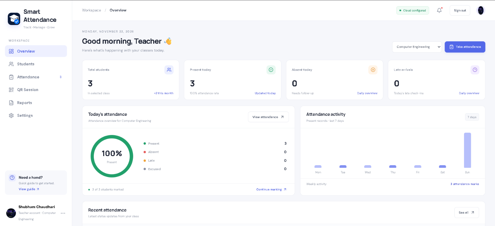
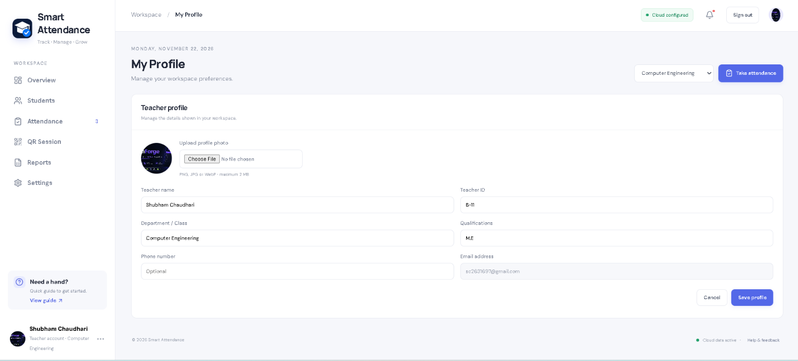
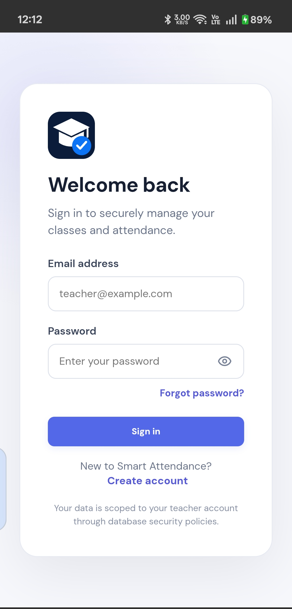
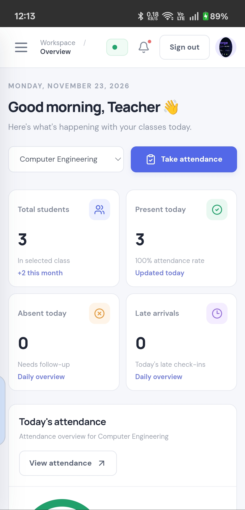
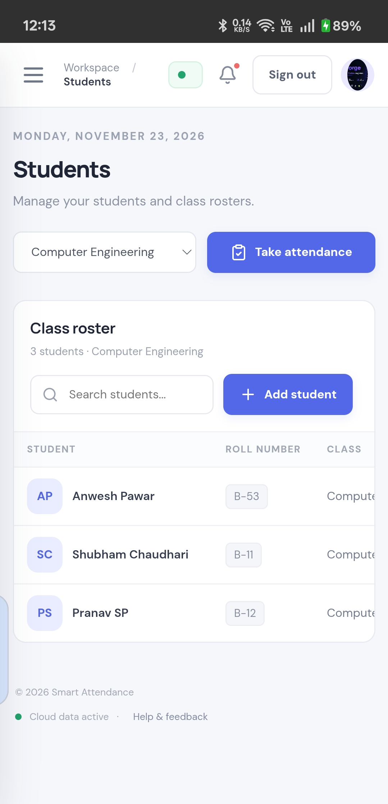
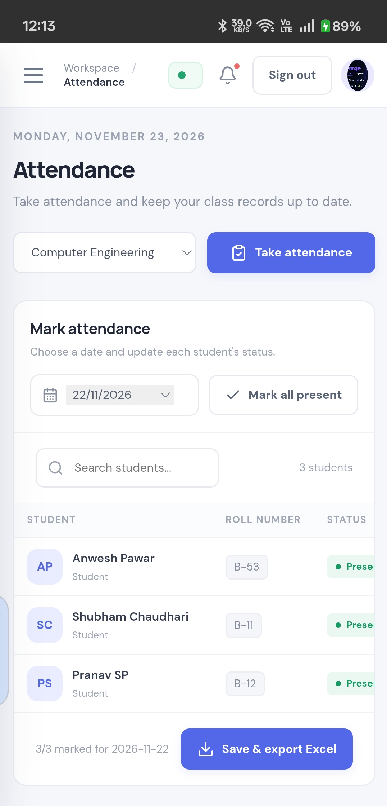
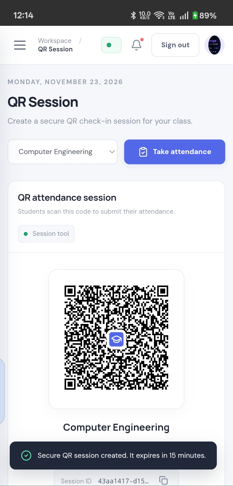
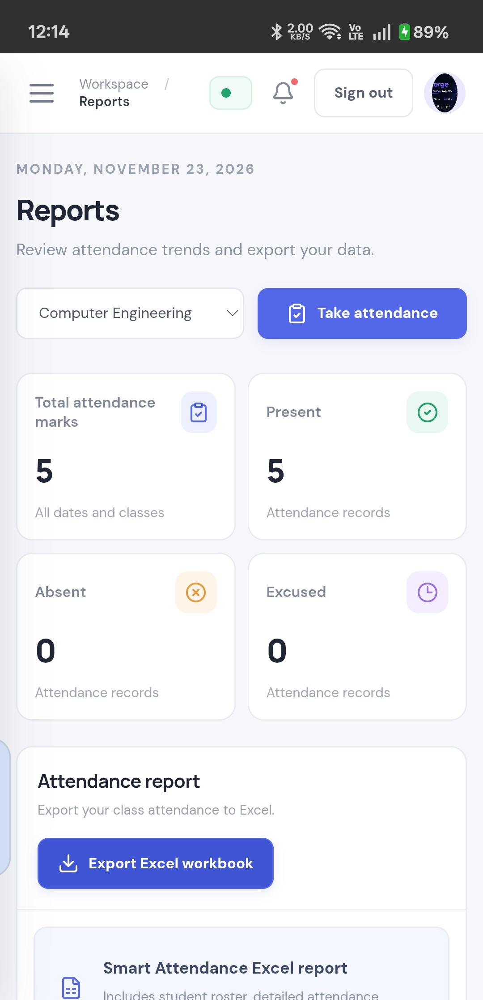

<div align="center">


# SMART ATTENDANCE

### Attendance made smarter. Management made simpler.

A modern digital attendance management platform designed to simplify classroom attendance, student management, and teacher workflows.

[🌐 Live Website](https://smart-attendance-shubh.vercel.app/) · [📦 Download Android App](https://github.com/Shubham07jee/smart-attendance/releases/tag/v1.0.0) · [🐛 Report an Issue](https://github.com/Shubham07jee/smart-attendance/issues)


</div>

---

## ⚡ About the Project

**Smart Attendance** is a digital attendance management system that brings essential classroom operations into one centralized platform.

Built for a simpler and more organized attendance experience, it helps teachers manage student records, track attendance, generate QR-based check-in sessions, and maintain their profiles.

The platform is available as a responsive web application and an Android application.

## ✨ Key Features

| Feature | Description |
|---|---|
| 🔐 Teacher Authentication | Registration, login, and password recovery |
| 📊 Dashboard | Centralized classroom and attendance overview |
| 👨‍🎓 Student Management | Add, search, and manage student records |
| ✅ Attendance Tracking | Record Present, Absent, Late, and Excused statuses |
| 📱 QR Attendance | QR-based student check-in workflow |
| 📑 Excel Export | Export attendance records into structured Excel workbooks |
| 📤 Native Android Sharing | Share exported Excel files using the Android sharing interface |
| 👤 Profile Management | Update teacher details and profile pictures |
| ☁️ Cloud Integration | Supabase authentication, database, and storage |
| 📲 Android Support | Native Android integration powered by Capacitor |

---

# 🖥️ Application Showcase

## Desktop Web Application

Explore the Smart Attendance web application and its classroom management interface.

### 01. Teacher Dashboard

<div align="center">

</div>

### 02. Attendance Management

<div align="center">

</div>

### 03. QR-Based Attendance

<div align="center">

</div>

### 04. Teacher Profile

<div align="center">

</div>

### 05. Teacher Registration

<div align="center">

</div>

---

## 📱 Mobile Android Application

Smart Attendance also delivers a mobile experience powered by Capacitor.

### 01. Mobile Login

<div align="center">

</div>

### 02. Mobile Dashboard

<div align="center">

</div>

### 03. Student Management

<div align="center">

</div>

### 04. Attendance Management

<div align="center">

</div>

### 05. QR-Based Attendance

<div align="center">

</div>

### 06. Excel Export

<div align="center">

</div>

---

## 🛠️ Technology Stack

| Category | Technology |
|---|---|
| Frontend | React, TypeScript |
| Build Tool | Vite |
| Styling | CSS |
| Backend | Supabase |
| Authentication | Supabase Auth |
| Database | Supabase PostgreSQL |
| File Storage | Supabase Storage |
| Android Integration | Capacitor |
| Excel Generation | SheetJS (xlsx) |
| Icons | Lucide React |

## 🏗️ System Architecture

<div align="center">

**TEACHER**

⬇️

**SMART ATTENDANCE APPLICATION**

⬇️

**REACT + TYPESCRIPT**

⬇️

**APPLICATION SERVICES**

⬇️

**SUPABASE BACKEND**

⬇️

**AUTHENTICATION · DATABASE · STORAGE**

⬇️

**WEB APPLICATION + ANDROID APPLICATION**

</div>

---

## 🚀 Getting Started

Follow these instructions to run Smart Attendance locally.

### Prerequisites

- Node.js (20 or newer recommended)
- npm
- Git
- A Supabase project

### 1. Clone the Repository

```bash
git clone https://github.com/Shubham07jee/smart-attendance.git
```

### 2. Navigate to the Project

```bash
cd smart-attendance
```

### 3. Install Dependencies

```bash
npm install
```

### 4. Configure Environment Variables

Create a file named `.env.local` in the project root.

Add your Supabase credentials:

```env
VITE_SUPABASE_URL=YOUR_SUPABASE_PROJECT_URL
VITE_SUPABASE_ANON_KEY=YOUR_SUPABASE_PUBLISHABLE_KEY
```

Replace the placeholders with your actual Supabase project URL and publishable key.

**Security:** Never expose your Supabase secret key or service-role key in frontend code. Never commit `.env.local` to GitHub.

### 5. Configure Supabase

1. Create a Supabase project.
2. Open the SQL Editor.
3. Apply the database migrations in the correct order:
   - `001_initial_schema.sql`
   - `002_qr_profile_features.sql`
4. Configure the required authentication settings.
5. Verify database and storage security policies.

### 6. Start the Development Server

```bash
npm run dev
```

Open the local URL displayed in your terminal.

Usually:

```text
http://localhost:5173
```

### 7. Create a Production Build

```bash
npm run build
```

The production frontend files are generated in the `dist/` directory.

---

## 📲 Android Application

Smart Attendance supports Android through Capacitor.

### Download the Latest Release

<div align="center">

### Smart Attendance v1.0.0

**First Official Release**

[⬇️ Download Android APK](https://github.com/Shubham07jee/smart-attendance/releases/tag/v1.0.0)

</div>

### Installation

1. Open the GitHub Releases page.
2. Download `app-release.apk`.
3. Open the downloaded APK on your Android device.
4. Allow installation from the relevant source if Android requests permission.
5. Install and launch Smart Attendance.

*This is a directly distributed Android APK, not a Play Store release.*

### Build Android Locally

Requirements:

- Android Studio
- Android SDK
- Compatible Java Development Kit

Build and synchronize the application:

```bash
npm run build
npx cap sync android
npx cap open android
```

You can then build and run the Android application through Android Studio.

---

## 🔐 Security

- Teacher authentication is managed through Supabase Auth.
- Database access should be protected through appropriate Row Level Security policies.
- Private credentials must never be committed to the repository.
- QR-based check-in should use appropriate identity verification and server-side validation in real-world deployments.

---

## 📦 Releases

All official versions and Android builds are available through GitHub Releases.

| Version | Description |
|---|---|
| [v1.0.0](https://github.com/Shubham07jee/smart-attendance/releases/tag/v1.0.0) | First Official Release |

[**Explore All Releases →**](https://github.com/Shubham07jee/smart-attendance/releases)

---

## 🗺️ Future Improvements

- Enhanced attendance analytics and reporting
- Improved student verification
- More attendance history and filtering options
- Additional Android improvements
- Expanded notification and classroom management features

---

## 🤝 Contributing

Contributions, suggestions, and bug reports are welcome.

1. Fork the repository.
2. Create a feature branch.
3. Make your changes.
4. Test your changes.
5. Submit a pull request.

[**Report an Issue →**](https://github.com/Shubham07jee/smart-attendance/issues)

---

## 👨‍💻 Developer

<div align="center">

### Shubham Chaudhari

**Developer of Smart Attendance**

[GitHub Profile](https://github.com/Shubham07jee) · [Project Repository](https://github.com/Shubham07jee/smart-attendance) · [Live Website](https://smart-attendance-shubh.vercel.app/)

---

### ✦ Making attendance management simpler. ✦

**If you find this project useful, consider giving it a ⭐**

</div>
