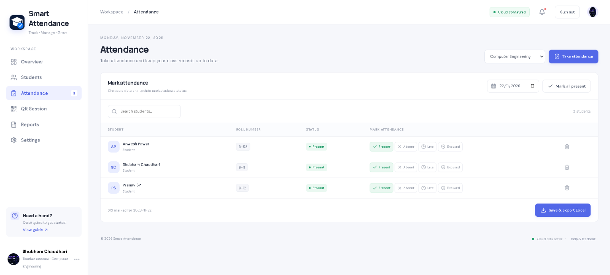
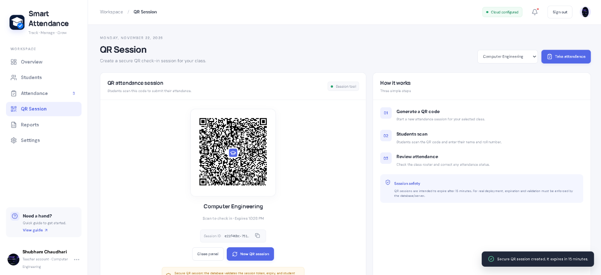
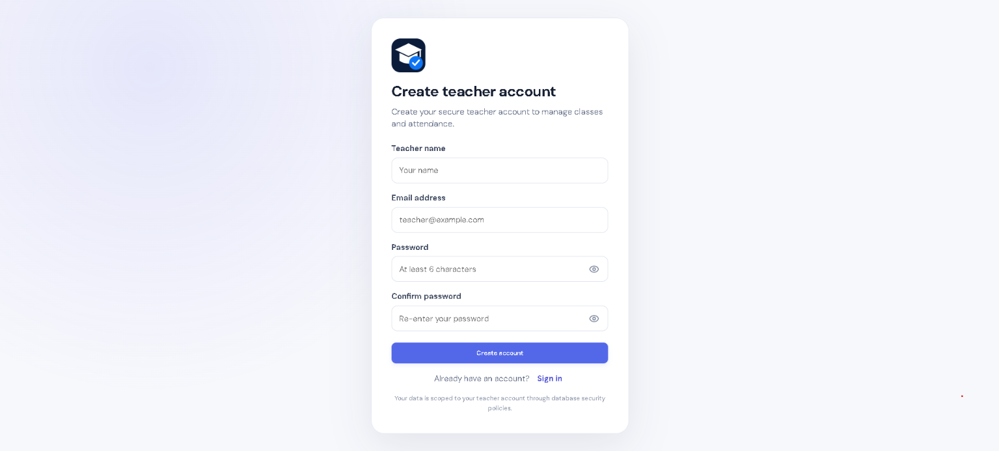

<div align="center">


# SMART ATTENDANCE

### ✦ Attendance made smarter. Management made simpler. ✦

A digital attendance management platform designed to simplify classroom attendance, student management, and teacher workflows.

[🌐 Live Website](https://smart-attendance-shubh.vercel.app/) · [📦 Releases](https://github.com/Shubham07jee/smart-attendance/releases) · [🐛 Report an Issue](https://github.com/Shubham07jee/smart-attendance/issues)


</div>

---

## ⚡ About the Project

**Smart Attendance** is a digital attendance management system that brings essential classroom operations into one centralized platform.

It helps teachers manage students, record attendance, generate QR-based check-in sessions, and maintain their profiles through a responsive web application and Android application.

The goal is to make attendance management simpler, more organized, and accessible.

---

## ✨ Key Features

| Feature | Description |
|:---|:---|
| 🔐 **Teacher Authentication** | Teacher registration, sign-in, and password recovery |
| 📊 **Dashboard** | Centralized attendance and classroom overview |
| 👨‍🎓 **Student Management** | Add, search, and manage student records |
| ✅ **Attendance Tracking** | Record Present, Absent, Late, and Excused statuses |
| 📱 **QR Attendance** | Generate QR codes for student check-in |
| 📑 **Excel Export** | Export attendance information into Excel |
| 👤 **Profile Management** | Update teacher details and profile picture |
| ☁️ **Cloud Integration** | Supabase authentication, database, and storage |
| 📲 **Android Support** | Android application powered by Capacitor |

---

## 🖥️ Application Preview

Explore the application:

[**Open Smart Attendance Live →**](https://smart-attendance-shubh.vercel.app/)

### 📊 Teacher Dashboard

<div align="center">

</div>

### ✅ Attendance Management

<div align="center">

</div>

### 📱 QR-Based Attendance

<div align="center">

</div>

### 👤 Teacher Profile

<div align="center">

</div>

### 🔐 Teacher Registration

<div align="center">

</div>

---

## 🛠️ Technology Stack

| Category | Technology |
|:---|:---|
| Frontend | React, TypeScript |
| Build Tool | Vite |
| Styling | CSS |
| Backend | Supabase |
| Authentication | Supabase Auth |
| Database | Supabase PostgreSQL |
| File Storage | Supabase Storage |
| Android Integration | Capacitor |
| Icons | Lucide React |

---

## 🏗️ System Architecture

<div align="center">

| Layer | Responsibility |
|:---|:---|
| 👨‍🏫 **Teacher** | Uses the attendance management platform |
| 🖥️ **Frontend** | React + TypeScript interface |
| ⚙️ **Application Services** | Handles application operations |
| ☁️ **Supabase** | Authentication, database, and storage |
| 📱 **Android** | Mobile application through Capacitor |

</div>

### Application Flow

<div align="center">

**TEACHER**

⬇️

**SMART ATTENDANCE**

⬇️

**REACT + TYPESCRIPT**

⬇️

**SUPABASE BACKEND**

⬇️

**AUTHENTICATION · DATABASE · STORAGE**

</div>

---

## 📂 Project Structure

```text
smart-attendance/
│
├── android/                  # Native Android project
│
├── legacy/                   # Legacy project files
│
├── src/                      # React application source
│
├── supabase/
│   └── migrations/           # Database SQL migrations
│
├── screenshots/
│   ├── README.md
│   ├── dashboard.png
│   ├── attendance.png
│   ├── profile.png
│   ├── signup.png
│   └── qr-attendance.png
│
├── app-icon.png              # Application logo
│
├── .env.example              # Environment template
├── .gitignore
├── capacitor.config.ts       # Capacitor configuration
├── index.html
├── package.json
├── package-lock.json
├── vite.config.ts
└── README.md
```

---

## 🚀 Getting Started

Follow these instructions to run Smart Attendance locally.

### Prerequisites

- Node.js (20 or newer recommended)
- npm
- Git
- A Supabase project

### 1. Clone the Repository

```bash
git clone https://github.com/Shubham07jee/smart-attendance.git
```

### 2. Navigate to the Project

```bash
cd smart-attendance
```

### 3. Install Dependencies

```bash
npm install
```

### 4. Configure Environment Variables

Create a file named `.env.local` in the root directory.

Add your Supabase credentials:

```env
VITE_SUPABASE_URL=YOUR_SUPABASE_PROJECT_URL
VITE_SUPABASE_ANON_KEY=YOUR_SUPABASE_PUBLISHABLE_KEY
```

Replace the placeholders with your actual Supabase project URL and publishable key.

**Important:** Never expose your Supabase secret key or service-role key in frontend code. Never upload `.env.local` to GitHub.

### 5. Configure Supabase

1. Create a Supabase project.
2. Open the SQL Editor.
3. Apply the migrations in the correct order:
   - `001_initial_schema.sql`
   - `002_qr_profile_features.sql`
4. Configure the required authentication settings.
5. Verify database and storage security policies.

### 6. Start the Development Server

```bash
npm run dev
```

Open the local URL shown in your terminal.

Usually:

```text
http://localhost:5173
```

### 7. Create a Production Build

```bash
npm run build
```

The production frontend files are generated in the `dist/` directory.

---

## 📱 Android Application

Smart Attendance also supports Android through Capacitor.

### Requirements

- Android Studio
- Android SDK
- Compatible Java Development Kit

### Build and Synchronize

Run these commands from the project root.

**Build the web application:**

```bash
npm run build
```

**Synchronize Android assets:**

```bash
npx cap sync android
```

**Open Android Studio:**

```bash
npx cap open android
```

You can then build and run the Android application using Android Studio.

---

## 🔒 Security

- Teacher authentication is managed through Supabase Auth.
- Database access uses Row Level Security (RLS) policies.
- Private credentials must never be committed to the repository.
- QR-based check-in should be combined with suitable identity verification and server-side validation for real-world deployments.

---

## 📦 Releases

Android builds and version history will be available through GitHub Releases.

[**Explore Smart Attendance Releases →**](https://github.com/Shubham07jee/smart-attendance/releases)

---

## 🗺️ Future Improvements

- Enhanced attendance analytics and reporting
- Improved student verification
- More attendance history and filtering options
- Additional Android improvements
- Expanded notification and classroom management features

---

## 🤝 Contributing

Contributions, suggestions, and bug reports are welcome.

1. Fork the repository.
2. Create a new feature branch.
3. Make your changes.
4. Test your changes.
5. Submit a pull request.

[**Report an Issue →**](https://github.com/Shubham07jee/smart-attendance/issues)

---

## 👨‍💻 Developer

<div align="center">

### Shubham Chaudhari

**Developer of Smart Attendance**

[GitHub Profile](https://github.com/Shubham07jee) · [Project Repository](https://github.com/Shubham07jee/smart-attendance) · [Live Website](https://smart-attendance-shubh.vercel.app/)

---

### ✦ Making attendance management simpler. ✦

**If you find this project useful, consider giving it a ⭐**

</div>
